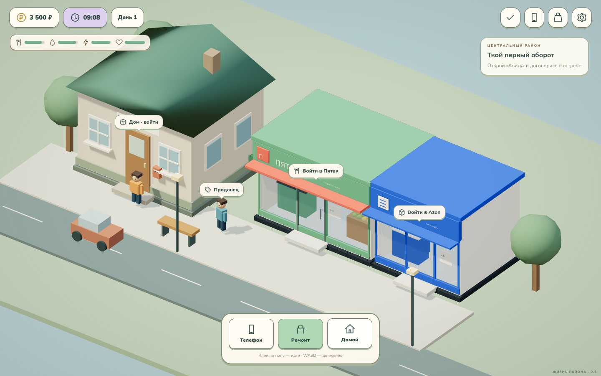

# С рук — Жизнь района · 0.3

Браузерная 3D-игра о покупке, ремонте и перепродаже смартфонов. Дом и мастерская, небольшой район, магазины, заказы жителей и свой компьютер.

**[Скачать автономную игру](releases/s-ruk-playable-0.3.zip)** — откройте `play.html`. Код, модели, звуки и шрифты уже внутри одного файла. Интернет для игры не нужен; требуется современный браузер с WebGL 2.

Если GitHub Pages включён, главная страница игры: **https://vithel2.github.io/game/**. При обновлении страницы используйте Ctrl+F5, чтобы браузер загрузил свежую сборку.



## Что изменилось в 0.3

- Снаружи дом имеет четыре стены, окна, дверь и крышу. После входа отображается отдельный интерьер — улица и внешняя модель дома в него не попадают.
- В «Пятак» и Azon можно войти. Внутри можно ходить, подойти к кассе, получить посылку или посмотреть компьютеры.
- Обновлены интерфейс и шрифты: локальные Nunito и Russo One с кириллицей.
- Добавлены звуковые эффекты Kenney: шаги, инструменты, интерфейс и награды. Анимируются персонаж, детали при снятии, инструменты, монеты, дверь дома, машина на улице, деревья и вентиляторы ПК.
- Вступление из трёх экранов и контекстные подсказки по восьми шагам первой сделки. Обучение можно скрыть и повторно открыть в настройках.
- Журнал: 13 заданий района, три ежедневных задания и три клиентских заказа на ремонт. Награды выдаются один раз.
- Заказы Тамары, Маши и Льва: клиентский телефон нельзя продать как свой, его нужно вернуть владельцу. За соблюдение срока даётся премия; при опоздании сохраняется основная оплата.
- Можно купить комплект ПК в Azon и улучшать оперативную память, видеокарту и накопитель. Улучшения видны на модели и влияют на встроенную игру.
- На телефоне есть игра «Лови сигнал», на ПК — «Ночной курьер». Рекорды сохраняются и засчитываются в задания.

## Первый игровой цикл

1. Пройдите вступление или откройте «Авиту» на телефоне.
2. Договоритесь о встрече на улице, посмотрите отзывы, осмотрите и купите аппарат.
3. Дома выберите его на рабочем столе: диагностика, восемь винтов, дисплей, три разъёма, неисправная деталь.
4. Закажите запчасть в Azon. После сна зайдите внутрь пункта выдачи и получите её у Маши.
5. Установите деталь, подключите шлейфы, закройте дисплей, верните винты и проведите финальную проверку.
6. Продайте собственный аппарат через «Мои телефоны». Клиентский аппарат возвращается владельцу за отдельную оплату.

В Azon есть не все запчасти. Дисплей R / 01 нужно получить с телефона-донора из «Авиту». Шлейф зарядки едет три игровых дня. Ремонт и доставка сохраняются, их можно отложить.

**Управление:** клик/касание пола — идти; подписи над предметами — взаимодействие; WASD на ПК; Escape — закрыть окно или отложить ремонт. Инструменты выбираются снизу. Чтобы уйти из магазина, нажмите «Выйти» и затем идите домой.

## Компьютер и мини-игры

Комплект Desk / 01 стоит 2 200 ₽ и выдаётся внутри Azon на витрине «Компьютеры». Дома для него уже стоит отдельный стол.

| Улучшение | Уровни | Влияние |
| --- | --- | --- |
| RAM | 4 → 8 → 16 ГБ | +10 секунд игры и дополнительная защита за уровень |
| GPU | Встроенная → Pixel G1 → Pixel G2 | Множитель очков ×1 → ×1,25 → ×1,5 |
| Накопитель | HDD 128 → SSD 256 → SSD 512 ГБ | Более быстрый запуск игры |

«Лови сигнал»: ловите зелёные пакеты касанием или мышью, избегайте красных помех. На клавиатуре можно использовать пробел.

«Ночной курьер»: меняйте полосу стрелками, A/D или кнопками, объезжайте заграждения, собирайте посылки. Обе мини-игры оригинальные и работают локально.

## Разработка и проверки

```sh
npm ci
npm run build
npm run serve
```

Исходники: `game/`. Готовая сборка: `web/game.js`, стили: `web/game.css`. Модели, новые помещения и внешний дом создаются в `game/world.js` и `game/locations.js`. GLB встраиваются при сборке, поэтому модели не требуют отдельных сетевых запросов.

```sh
npx playwright install chromium
npm run test:state
npm run test:e2e
npm run test:expansion
npm run test:mobile
npm run package:offline
```

Для системного Chromium можно задать `BROWSER_BIN=/usr/bin/chromium`. Браузерные тесты сами запускают временный HTTP-сервер.

Проверены: обычная сделка целиком, клиентский заказ целиком с премией и возвратом владельцу, запрет повторной выплаты, входы в здания, покупки, три улучшения ПК, достижение целей в мини-играх, звук и отключение звука, сохранение после перезагрузки, перенос сохранения 0.2 в новую схему. Мобильная проверка использует касания при размере 390 × 844. Это не замена тестированию производительности на реальном Android-устройстве.

Сохранения предыдущей версии переносятся автоматически в том же браузере и источнике страницы. При запуске разных файлов с диска браузер может хранить прогресс отдельно для каждого пути; для сохранения прогресса автономного файла обновляйте его по прежнему пути.

## Источники звуков и шрифтов

- Звуки — официальный **Kenney Starter Kit 3D Platformer**, CC0 для аудио. Оригинальные файлы и сведения об источнике находятся в [`web/audio`](web/audio).
- **Nunito** и **Russo One** — Google Fonts, SIL Open Font License 1.1. Лицензии находятся в [`web/fonts`](web/fonts).
- Three.js — MIT; лицензия включена в `web/THREE-LICENSE.txt`.

Все перечисленные ресурсы включены в сайт и автономный архив; во время игры они не скачиваются с внешних сайтов.

## GitHub Pages и модели

Pages: **Settings → Pages → Deploy from a branch → main → / (root) → Save**. Готовая сборка уже в репозитории, серверная сборка не требуется.

Модели Blender/GLB и ранние прототипы сохранены в `art/prototypes`, `art/prototypes_v2`, `art/expansion_01`. Скрипты пересоздания находятся в `tools`. Старый отдельный макет телефона больше не является главной страницей.

Это развивающаяся браузерная версия. Отдельных APK/Windows-сборок, нескольких покупаемых домов и большого города пока нет. Внутренности техники и ремонт условные, рассчитаны на игровой процесс.
