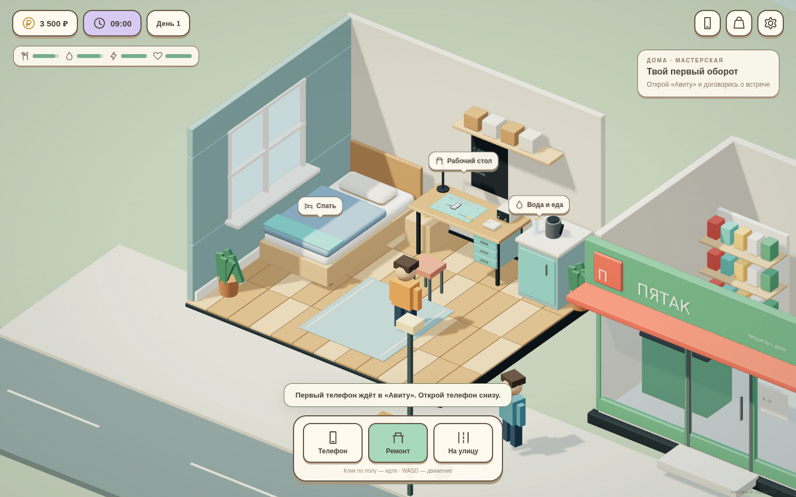

# С рук — Первый оборот

Первая игровая версия симулятора покупки, ремонта и перепродажи смартфонов. Браузерная 3D-игра с изометрической комнатой, персонажем, улицей и отдельной сценой ремонта.

## Играть

Откройте **[vithel2.github.io/game](https://vithel2.github.io/game/)**, если GitHub Pages включён. Либо скачайте репозиторий, полностью распакуйте ZIP и откройте `index.html` в браузере с поддержкой WebGL 2. Скомпилированные JS, CSS и модели уже включены; подключение к CDN и установка Node.js для игры не нужны.

Для отдельной автономной версии скачайте [`releases/s-ruk-playable-0.2.zip`](releases/s-ruk-playable-0.2.zip) и откройте `play.html`. В этом файле уже встроены стили, код, модели и текстуры.



Начальный экран показывает мастерскую и кнопку «Открыть мастерскую». Старый отдельный макет телефона сохранён в `art/expansion_01/phone_demo.html`; он больше не является главной страницей.

## Что делать

1. Откройте телефон → «Авиту», выберите объявление и договоритесь о встрече.
2. На улице подойдите к продавцу. Посмотрите отзывы, осмотрите телефон и купите его.
3. Вернитесь домой и возьмите телефон на рабочий стол.
4. Проведите диагностику, отвёрткой снимите восемь винтов, присоской поднимите дисплей, лопаткой отключите питание и шлейфы.
5. Снимите неисправную деталь. Недостающую запчасть закажите в Azon; после сна заберите её в пункте выдачи на улице.
6. Установите деталь, подключите шлейфы, закройте дисплей и верните винты. Проверьте телефон и продайте его через «Мои телефоны».

Дисплей отсутствует в каталоге Azon: его можно получить, купив донора в «Авиту». Заказ шлейфа зарядки занимает три игровых дня. У продавцов различаются отзывы, описания и история ремонта. Неправильный инструмент не выполняет действие. Неисправность, этапы ремонта, деньги, заказы и инвентарь сохраняются автоматически.

Есть сытость, вода, энергия, здоровье, сон, продукты в «Пятаке», репутация, улучшение рабочего места и цель — восстановить и продать три телефона. Энергия заканчивается при работе; при голоде или жажде она расходуется быстрее. После трёх сделок можно продолжать играть.

**Управление:** клик/касание пола — идти; WASD на ПК; подписи над предметами — взаимодействие; инструменты — нижняя панель; Escape — закрыть окно или отложить ремонт. Полный цикл ремонта доступен обычными кликами и касаниями.

## Разработка

```sh
npm ci
npm run build
npm run serve
```

Откройте адрес локального сервера из терминала. Исходники игры — `game/`, готовая сборка — `web/game.js`, стили — `web/game.css`. Сборщик встраивает GLB и текстуры в обычный JS, поэтому главная страница не зависит от загрузки моделей через `fetch` и может работать из распакованной папки. Уведомления, интерфейсы приложений и сохранение реализованы локально: реальных платежей и внешних аккаунтов нет.

Браузерные проверки:

```sh
npx playwright install chromium
npm run test:e2e
npm run test:mobile
```

Для системного Chromium можно задать `BROWSER_BIN=/usr/bin/chromium`. Первый тест проходит всю сделку до продажи и перезагрузки; второй проверяет касания, разборку и заказ на экране 390 × 844. Тесты сами запускают временный HTTP-сервер. Автономный архив пересобирается командой `npm run package:offline`.

Проверка WebGL в Chromium использует программный рендерер в облачной среде. Это не замена замерам производительности на реальном Android-устройстве.

## GitHub Pages

**Settings → Pages → Source: Deploy from a branch → Branch: main → / (root) → Save**. Сборка на сервере не требуется: `index.html` и готовая папка `web` уже в репозитории.

## Модели

- [`art/prototypes`](art/prototypes) — комната и рабочий стол.
- [`art/prototypes_v2`](art/prototypes_v2) — смартфон с «Авиту».
- [`art/expansion_01`](art/expansion_01) — магазины, инструмент, зарядка, разборный телефон, GLB/Blender и превью.
- [`tools`](tools) — пересоздание моделей, интерфейсов и браузерной сборки.

Это первая игровая версия, не законченный релиз. Пока нет отдельной APK/Windows-сборки, большого города, нескольких покупаемых домов, сложного торга и полной симуляции электроники. Анимации и внутренности телефона условные, управление рассчитано на доступный игровой ремонт. Названия «Авиту», Azon и «Пятак» рабочие; проверка прав перед релизом остаётся отдельной задачей.

Three.js распространяется по MIT; лицензия включена в `web/THREE-LICENSE.txt`.
