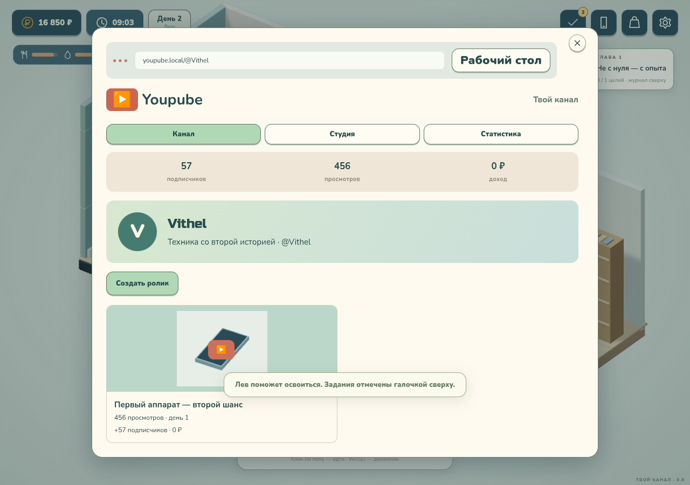

# С рук — Твой канал · 0.6

Офлайн-игра о ремонте техники и возвращении к своему делу. Разработчик — **Vithel**. Создано с помощью **GPT-6.1 Sol**.

**[Скачать версию 0.6](releases/s-ruk-playable-0.6.zip)** — распакуйте архив и откройте `play.html` в браузере с WebGL 2. Модели, музыка, звуки, шрифты и код находятся внутри одного HTML. Интернет во время игры не нужен.

## Что изменилось в 0.6

- Новые округлые кисти с фалангами и предплечьями. У отвёртки контрастная метка и рёбра: вращение видно, кисть перехватывает рукоять, наконечник остаётся у винта.
- Полностью пересобраны корпус и внутренности ремонтируемого телефона. Шлейфы короткие, детали аккуратно уложены. При переносе экрана исходник сразу скрывается; запчасть на столе совпадает с устанавливаемой моделью.
- Поворот использует направление фактического перемещения. При резкой смене маршрута персонаж сначала разворачивается. Исправлено влияние позы после сна/отдыха на дальнейшую ходьбу.
- Продажа через «Авиту»: личная встреча, проверка аппарата покупателем и передача, либо отправка у стойки Azon. Посылка идёт один игровой день; деньги приходят после получения. Рейтинг продавца, отзывы, история последних трёх продаж. Повторная оплата исключена.
- Youpube на домашнем ПК — игровой сайт с каналом, студией и статистикой. Нужно снять три кадра, выбрать подходящий план и поймать момент съёмки, затем задать темп монтажа, название и обложку. Качество влияет на аудиторию. Канал и снятые ролики можно открыть с ПК и телефона; публикации имеют игровой просмотр, без экспорта настоящего видео.
- Календарь на стене дома: сезоны, сроки заказов, приходы посылок, встречи и свои заметки по дням. Напоминания сохраняются.
- Два музыкальных трека автоматически чередуются примерно раз в 85 секунд даже без смены локации. Укрупнены и заменены вывески «Продукты у дома» и «Пункт выдачи».
- Сохранения 0.5 и более ранних версий продолжают работать.



В игре также есть 14 глав, четыре сезона с освещением дня/ночи, четыре уровня ремонта, подработки в магазинах, сквер, друзья, еда, сон, ПК и две мини-игры. [Предыдущая версия 0.5](docs/validation-0.5.md).

## Как играть

В новой игре выберите ник, пол и одну из шести способностей. Обязательное обучение проведёт через первую сделку, ремонт, заказ детали, сон, получение посылки и продажу. Оранжевая подсветка показывает нужный инструмент или действие.

Клик/касание пола — идти; WASD — ходить на ПК. Кнопки над предметами — взаимодействие. Нижняя панель позволяет вернуться домой или открыть карту. В магазине сначала возьмите корзину, выберите продукты на полках и оплатите на кассе. Купленные продукты можно съесть из инвентаря сверху.

Обычная работа с техникой начинается в «Авиту». Сложный аппарат после влаги появляется с третьего дня, экспертный — с седьмого. В Azon есть не все детали: дисплей можно получить с донора, а иногда найти в сквере. Новые предложения появляются каждый день. Сон восстанавливает силы и продвигает доставку; отдых на диване и в сквере доступен раз в день.

Подработки доступны у стойки внутри магазина и Azon, а также через вкладку «Работа» в журнале — персонаж сам проложит маршрут. Работа не требует покупок из своего кармана.

В Youpube можно снимать влоги, набирать аудиторию, подключать монетизацию, брать рекламу и соревноваться с игровыми авторами. На домашнем ПК нажмите Youpube → Студия; на телефоне приложение доступно с главного экрана. Три съёмки, выбор монтажа и оформления дают готовый черновик. После публикации новый ролик станет доступен на следующий игровой день. ПК продаётся в Azon за 2 200 ₽; RAM, GPU и SSD улучшаются дома. На телефоне есть «Лови сигнал», на ПК — «Ночной курьер».

Прогресс сохраняется автоматически. Старые сохранения переносятся в новую схему, включая текущий ремонт. Для автономного HTML обновляйте файл по прежнему пути: другой путь или браузер могут иметь отдельное хранилище.

## Сборка

```sh
npm ci
npm run build
npm run serve
```

Исходники — `game/`, сборка — `web/game.js` и `web/game.css`. GLB, аудио и шрифты встраиваются в автономный файл. Новые модели, помещения и эффекты создаются программно. Скрипт архивации: `tools/package_game.py`.

```sh
npx playwright install chromium
npm run test:state
npm run test:life
npm run test:navigation
npm run test:progression
npm run test:trading
npm run test:repair-motion
npm run test:release
npm run test:release-mobile
npm run test:e2e
npm run test:gadgets
npm run test:advanced
npm run test:shifts
npm run test:animation
npm run test:season
npm run test:rework
npm run test:expansion
npm run test:mobile
npm run test:resume
npm run test:offline
```

Браузерные тесты запускают временный сервер. Можно задать `BROWSER_BIN=/usr/bin/chromium`. [Отчёт о проверках 0.6](docs/validation-0.6.md).

## Источники и ограничения

Звуки Kenney — CC0. Композиции HoliznaCC0 получены в пользовательском архиве; источник и сведения о лицензиях записаны в [web/audio/SOURCES.md](web/audio/SOURCES.md). Треки с некоммерческими ограничениями или без сведений об источнике не включены. Перед коммерческим релизом необходимо подтвердить права на распространение присланной музыки.

Nunito и Russo One — SIL OFL, Three.js — MIT. Лицензии и сведения об аудио включены в скачиваемый архив.

Это браузерная игровая версия; отдельных APK и Windows-сборки пока нет. Фоновые здания декоративные, сетевого рейтинга нет, ремонт условный. Мобильный интерфейс проверяется касаниями при 390 × 844; производительность на реальном Android пока не измерялась.

GitHub Pages после включения: https://vithel2.github.io/game/. Настройка: **Settings → Pages → Deploy from a branch → main → / (root)**. Ранние модели и прототипы сохранены в `art/`.
