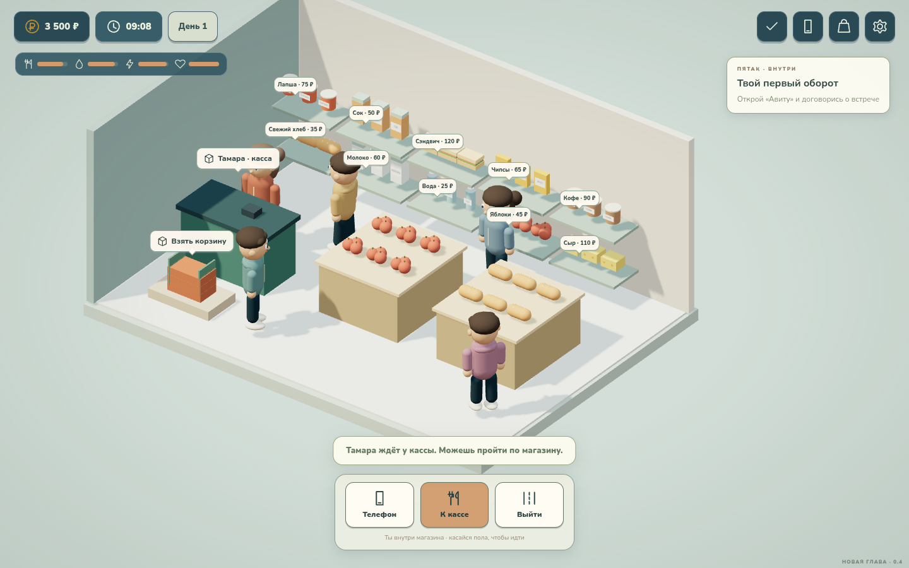

# С рук — Жизнь района · 0.4

Браузерная 3D-игра о восстановлении техники и возвращении к своему делу.

**[Скачать автономную игру 0.4](releases/s-ruk-playable-0.4.zip)** — распакуйте архив и откройте `play.html`. Модели, звуки, шрифты и код находятся внутри файла. Интернет для игры не нужен, нужен браузер с WebGL 2.

## Новое в 0.4

- История потери бизнеса, выбор ника, пола и одной из шести способностей. Бегун быстрее ходит, прошаренный дешевле покупает технику, силач несёт 14 товаров вместо 8, умник экономит на ПК, золотые руки экономят время и силы при ремонте, харизматичный быстрее развивает канал.
- Обязательное обучение первой сделке: подсветка и указатель ведут к нужной кнопке, месту, инструменту или детали. Заканчивается после ремонта и продажи, пропуска нет.
- Сон на кровати с коротким переходом от вечера через ночь к утру. Еда, питьё и запись влога выполняются персонажем с предметом в руке.
- Обход мебели при клике и столкновения при WASD. Выход из магазина и Azon возвращает к соответствующему зданию.
- Расширенный «Пятак»: десять продуктов с моделями, покупатели, корзина, перенос продуктов с полки и оплата у Тамары. Купленные продукты лежат в инвентаре.
- Модели товаров в каталогах Авиту и Azon, постоянная высота телефона, читаемые кнопки на ПК.
- Продавец появляется после назначения встречи и уходит после сделки. Продавцы отличаются внешностью. На улице есть прохожие, друзья и фоновые дома.
- Ремонт: вертикальная отвёртка совмещается с винтом; дисплей открывается на шлейфах и откладывается рядом; инструменты подсвечиваются оранжевым, их можно взять с коврика. Полученная запчасть появляется на столе до установки.
- Кроме смартфонов, в Авиту есть геймпады, колонки и наушники: отдельные модели и ремонт с четырьмя винтами.
- Youpube: пять тем влогов, съёмка и публикация, подписчики, монетизация после 500 подписчиков и трёх роликов, реклама раз в три дня. Реклама уменьшает аудиторию на 3%. Игровые соперники растут каждый день; за обгон выдаётся однократная награда.
- Лев, Денис и Лиза: знакомство, совместные ролики и соревнования в мини-играх. 17 заданий района, три ежедневных задания и три клиентских заказа.



## Как играть

Первое обучение проведёт через Авиту, встречу и осмотр, покупку, диагностику, ремонт, доставку запчасти и продажу. Новые предложения появляются каждый игровой день. Доставку продвигает сон. Дисплей нужно получить с донора: в Azon его нет.

Клик или касание пола — идти; WASD — ходить на ПК. Подписи над предметами — взаимодействие. В магазине сначала возьмите корзину, затем нажимайте продукты на полках и идите к кассе. Инвентарь открывается кнопкой сумки сверху. Escape закрывает окно или откладывает ремонт.

ПК продаётся за 2 200 ₽ внутри Azon. RAM, GPU и SSD улучшаются дома и влияют на игру «Ночной курьер». На телефоне есть «Лови сигнал». Рекорды сохраняются. Клиентскую технику нужно вернуть владельцу у стойки, чтобы получить оплату и премию за срок.

Прогресс сохраняется автоматически в браузере. Сохранения 0.2/0.3 переносятся в новую схему. Для автономной версии обновляйте файл по прежнему пути: разные пути и браузеры могут иметь отдельные сохранения.

## Сборка и проверки

```sh
npm ci
npm run build
npm run serve
```

Результаты проверок — [docs/validation-0.4.md](docs/validation-0.4.md).

Исходники — `game/`, готовая сборка — `web/game.js` и `web/game.css`. Новые модели товаров и персонажей создаются программно; исходные GLB встраиваются при сборке. CDN не используется.

```sh
npx playwright install chromium
npm run test:state
npm run test:life
npm run test:navigation
npm run test:e2e
npm run test:rework
npm run test:resume
npm run test:gadgets
npm run test:expansion
npm run test:mobile
npm run package:offline
npm run test:offline
```

Браузерные тесты запускают собственный временный сервер. Можно использовать системный Chromium через `BROWSER_BIN=/usr/bin/chromium`. Автономный HTML проверяется отдельно через локальный сервер с контролем отсутствия внешних запросов. Проверка мобильного интерфейса выполняется касаниями при размере 390 × 844; производительность на реальном Android требует отдельной проверки.

## Звуки и лицензии

Встроены шесть звуков Kenney Starter Kit 3D Platformer (CC0). Источники и лицензии — [`web/audio`](web/audio). Для расширения подходят официальные бесплатные пакеты [Interface Sounds](https://kenney.nl/assets/interface-sounds) и [Impact Sounds](https://kenney.nl/assets/impact-sounds), также CC0. Эти два дополнительных пакета в сборку пока не включены.

Nunito и Russo One поддерживают кириллицу и распространяются по SIL OFL; лицензии — [`web/fonts`](web/fonts). Three.js — MIT. Лицензии включены в автономный архив.

## Публикация

Готовая сборка хранится в репозитории. GitHub Pages: **Settings → Pages → Deploy from a branch → main → / (root)**. Адрес после включения Pages: https://vithel2.github.io/game/.

Исходные модели и ранние прототипы сохранены в `art/`, скрипты — в `tools/`.

Это развивающаяся браузерная игра. APK и отдельной Windows-сборки пока нет. Фоновые дома декоративные; большой открытый город и сетевое соревнование не реализованы. Ремонт техники условный, для игрового процесса.
