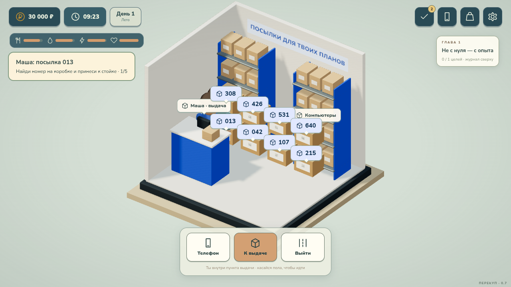

# Перекуп: второй шанс · 0.9

**Из чужого хлама — в своё дело.** Офлайн-игра о ремонте, сделках и возвращении к своему бизнесу. Разработчик: **Vithel**. Создано с помощью **GPT-6.1 Sol**.

- **[Установщик Windows 10/11 x64](releases/Perekup-0.9-Setup.exe)** · **[Портативная версия с EXE](releases/perekup-0.9-windows-portable.zip)** · [Требования и сборка](docs/windows-build.md).
- **[Скачать APK для Android](releases/perekup-0.9-debug.apk)** — тестовая установка, Android 8.0+ и WebView с WebGL 2. [Как собирать и подписывать](docs/android-build.md).
- **[Скачать браузерную игру 0.9](releases/perekup-second-chance-0.9.zip)** — распаковать и открыть `play.html`.
- **[Материалы для магазина одним архивом](releases/perekup-media-0.7.zip)** — открыть `index.html` внутри архива для просмотра.
- **[Новый трейлер 1080p / 60 fps](marketing/0.9/trailer-1080p60.mp4)** · **[Видео прохождения обучения](marketing/0.9/tutorial.mp4)** · [Иконка](marketing/0.7/icon-512.png) · [Мобильные кадры](marketing/0.7/mobile/) · [ПК-кадры](marketing/0.7/pc/) · [Описание для RuStore](marketing/0.7/ru-store-listing.md).

## Что изменилось в 0.9

- Ремонт начинается с диагностики, затем прогрева (если нужен), поднятия дисплея и отключения шлейфов. Винты внутренней рамки выкручиваются после этого. Их теперь **3, 5, 6 или 7** по сложности, максимум семь. Старый прогресс 8–12 винтов сохраняется.
- Отсоединённый дисплей лежит горизонтально на коврике, пока снимается/закрепляется рамка. Отвёртка сначала поднимается, проходит выше дисплея и опускается к винту. После ремонта рамка закрепляется до подключения экрана и закрытия корпуса.
- Помещение Azon заметно увеличено: большой стеллаж, широкие проходы, отдельная стойка, полки и места ожидания. Кодированные коробки появляются только во время активной подработки.
- Взятие посылки показывает движение с полки в руки, передача Маше выполняется у стойки. После выдачи следующий код сразу отображается на постоянной подсказке и в сообщении Маши. Повторно открывать подработку не нужно.
- У дома мастера отдельный просторный кабинет внутри, а снаружи — второй этаж с окнами и балконом. Дом мечты получает дополнительную зону дальше; навигация и границы комнат расширяются.
- Прохожие и друзья уходят по разным расписаниям с вечера. Они идут к выходам улицы и плавно исчезают у её края; утром возвращаются постепенно.
- Доступны настоящий установщик Windows, портативная версия с EXE и APK 0.9. Установщик создаёт ярлыки и удаление через настройки Windows, прогресс при удалении сохраняется.
- Новый трейлер рендерится в 1920×1080/60 fps, отдельно записано короткое прохождение обязательного обучения с подсказками.

[Проверки 0.9](docs/validation-0.9.md) · [Windows](docs/windows-build.md) · [APK](docs/android-build.md).

## Что изменилось в 0.8

- Понятные названия вымышленных моделей: **Aster 13 mini**, **Qubo Neo 10**, **Aster 13 Pro**. Старые названия в сохранениях и истории продаж обновляются, прогресс остаётся.
- В прогреве, пайке и калибровке проверяется видимое положение стрелки **в момент нажатия**, а не отпускания. После обновления окна стрелка сразу стоит в правильном месте. Есть отдельные иконки фена, кисти, паяльника, герметика и мультиметра; подсказка «взять» показывает нужный инструмент.
- Внутренние винты затягиваются **до герметизации и закрытия дисплея**. Старые незаконченные ремонты продолжаются с учётом этого порядка.
- На экране проверяемого телефона видны характеристики модели, заряд, мощность зарядки, скорость загрузки/отдачи и ping. Это внутриигровая диагностика без доступа к реальному интернету. После ремонта отчёт остаётся открытым, пока игрок не заберёт аппарат.
- Съёмка кадра занимает несколько секунд: персонаж поднимает телефон, жестикулирует, камера приближается, видны рамка REC и таймер. После съёмки сохраняется кадр для монтажа.
- Добавлен Cordova-проект и GitHub Actions для тестового APK. При наличии секретов постоянной подписи workflow дополнительно создаёт APK для магазина. Секретный ключ не выкладывается в репозиторий или артефакты.

[Проверки 0.8](docs/validation-0.8.md) · [Сборка APK](docs/android-build.md).

## Что изменилось в 0.7

- Одновременно видны максимум четыре активных задания. После получения награды появляется следующее.
- Подработка в Azon: Маша называет трёхзначный код. Найди физическую коробку на полке, возьми и донеси к стойке. Ошибка уменьшает оплату. Выбор работы в Пятаке больше не отправляет в Azon; сначала нужно закончить и получить оплату за другую активную смену.
- Исправлена покупка продуктов из окна кассы; отдельно проверен сыр.
- Плавное появление и закрытие телефона, переходы приложений. Рука в ремонте укорочена; присоска наклоняется вместе с дисплеем. Разъёмы при отсоединении приподнимаются, шлейфы опускаются и остаются у экрана. Телефон и отложенный дисплей стоят на коврике.
- Низкие показатели подсвечиваются; при нуле появляются затемнение и лёгкое головокружение. Истощение снижает HP. При падении шанс помощи дома — 30%, если есть хотя бы один друг; в общественных местах — 80%. Удачная помощь ведёт в больницу, неудачная завершает историю. Исход сохраняется, перезагрузка не меняет шанс.
- Ночью на улице остаётся один обычный прохожий, друзья уходят домой. Иногда появляются ночные угрозы: можно убежать, договориться или отдать деньги.
- Новый магазин «Обставься», пять предметов мебели с отдельными моделями, покупка и хранение. Четыре уровня жилья: стартовая комната, уютный дом, дом мастера, дом мечты с дополнительной зоной. Мебель размещается в заданных местах.
- Новое название, иконка, слоган, описание магазина, шесть скриншотов и трейлер с музыкой и записанными игровыми звуками.



Сохранились 14 глав истории, четыре сезона, ремонт техники разной сложности, личные продажи и доставка, рейтинг продавца, Youpube, друзья, ПК и мини-игры. [Отчёт 0.6](docs/validation-0.6.md).

## Как играть

В новой игре выберите ник, пол и одну из шести способностей. Обязательное обучение проведёт через первую сделку, ремонт, заказ детали, сон, получение посылки и продажу. Оранжевая подсветка показывает нужный инструмент или действие.

Клик/касание пола — идти; WASD — ходить на ПК. Кнопки над предметами — взаимодействие. Нижняя панель позволяет вернуться домой или открыть карту. В магазине сначала возьмите корзину, выберите продукты на полках и оплатите на кассе. Купленные продукты можно съесть из инвентаря сверху.

Обычная работа с техникой начинается в «Авиту». Сложный аппарат после влаги появляется с третьего дня, экспертный — с седьмого. В Azon есть не все детали: дисплей можно получить с донора, а иногда найти в сквере. Новые предложения появляются каждый день. Сон восстанавливает силы и продвигает доставку; отдых на диване и в сквере доступен раз в день.

Подработки доступны у стойки внутри магазина и Azon, а также через вкладку «Работа» в журнале — персонаж сам проложит маршрут. Работа не требует покупок из своего кармана.

В Youpube можно снимать влоги, набирать аудиторию, подключать монетизацию, брать рекламу и соревноваться с игровыми авторами. На домашнем ПК нажмите Youpube → Студия; на телефоне приложение доступно с главного экрана. Три съёмки, выбор монтажа и оформления дают готовый черновик. После публикации новый ролик станет доступен на следующий игровой день. ПК продаётся в Azon за 2 200 ₽; RAM, GPU и SSD улучшаются дома. На телефоне есть «Лови сигнал», на ПК — «Ночной курьер».

Прогресс сохраняется автоматически. Старые сохранения переносятся в новую схему, включая текущий ремонт. Для автономного HTML обновляйте файл по прежнему пути: другой путь или браузер могут иметь отдельное хранилище.

## Сборка

```sh
npm ci
npm run build
npm run serve
```

Исходники — `game/`, сборка — `web/game.js` и `web/game.css`. GLB, аудио и шрифты встраиваются в автономный файл. Новые модели, помещения и эффекты создаются программно. Скрипт архивации: `tools/package_game.py`.

```sh
npx playwright install chromium
npm run test:state
npm run test:life
npm run test:navigation
npm run test:progression
npm run test:release7
npm run test:release8
npm run test:release9
npm run test:release9-browser
npm run test:release8-browser
npm run test:trading
npm run test:repair-motion
npm run test:release
npm run test:release-mobile
npm run test:e2e
npm run test:gadgets
npm run test:advanced
npm run test:shifts
npm run test:animation
npm run test:season
npm run test:rework
npm run test:expansion
npm run test:mobile
npm run test:resume
npm run test:offline
```

Браузерные тесты запускают временный сервер. Можно задать `BROWSER_BIN=/usr/bin/chromium`. [Проверки версии 0.7](docs/validation-0.7.md).

## Источники и ограничения

Звуки Kenney — CC0. Композиции HoliznaCC0 получены в пользовательском архиве; источник и сведения о лицензиях записаны в [web/audio/SOURCES.md](web/audio/SOURCES.md). Треки с некоммерческими ограничениями или без сведений об источнике не включены. Перед коммерческим релизом необходимо подтвердить права на распространение присланной музыки.

Nunito и Russo One — SIL OFL, Three.js — MIT. Лицензии и сведения об аудио включены в скачиваемый архив.

Доступны браузерная версия для ПК/телефона и тестовый APK с отладочной подписью. Для Windows есть EXE и установщик на базе WebView2; для публикации APK в RuStore нужен постоянный ключ разработчика. Фоновые здания декоративные, сетевого рейтинга нет, ремонт условный. Мобильный интерфейс проверяется касаниями при 390 × 844; производительность на реальном Android пока не измерялась.

GitHub Pages после включения: https://vithel2.github.io/game/. Настройка: **Settings → Pages → Deploy from a branch → main → / (root)**. Ранние модели и прототипы сохранены в `art/`.
