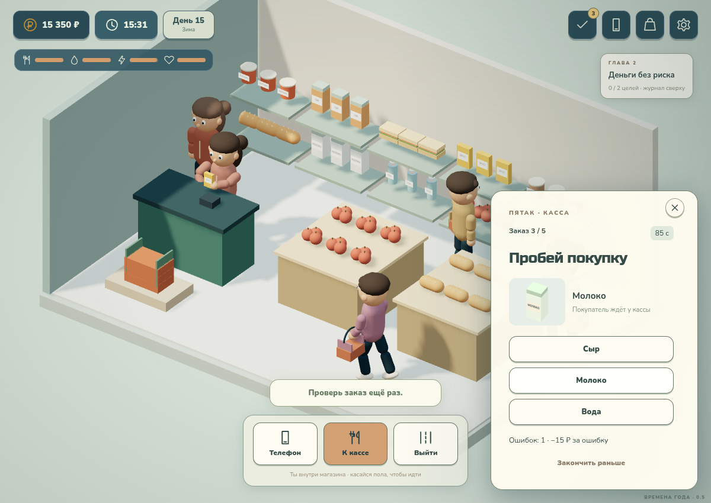

# С рук — Времена года · 0.5

Офлайн-игра о ремонте техники и возвращении к своему делу. Разработчик — **Vithel**. Создано с помощью **GPT-6.1 Sol**.

**[Скачать версию 0.5](releases/s-ruk-playable-0.5.zip)** — распакуйте архив и откройте `play.html` в браузере с WebGL 2. Модели, музыка, звуки, шрифты и код находятся внутри одного HTML. Интернет во время игры не нужен.

## Что изменилось

- Удалены передние декоративные дома, перекрывавшие улицу. Район расширен, камера следует за персонажем; появилась карта для выбора маршрута.
- Дома добавлена жилая зона с диваном и книжным шкафом. В сквер можно дойти, отдохнуть и раз в день осмотреть старую технику на запчасти.
- Игровое время идёт во время игры: одна реальная секунда — одна игровая минута после завершения обучения. Освещение и цвет неба постепенно меняются; ночью светятся окна и фонари. Каждые семь игровых дней меняется сезон: лето, осень, зима, весна. Зимой есть снег и снежные крыши, осенью меняется цвет листвы.
- Персонажи получили локти, кисти и колени. Еда и вода подносятся к лицу, персонаж поворачивается для читаемой анимации. При ремонте видны руки; присоска следует за дисплеем, отвёртка вращается у винта, детали переносятся в лоток. Сетка теперь ограничена прямоугольником коврика.
- Четыре уровня ремонта: быстрый, обычный, сложный и экспертный. Различаются число винтов и разъёмов, набор операций и число неисправных деталей. Для сложных работ есть фен, кисть, паяльник, герметик и мультиметр. Прогрев, пайка и калибровка требуют попасть в рабочую зону прибора.
- Переработаны корпуса колонки и наушников: у колонки раскрывается половина корпуса, у наушников ремонтируется чашка. Геймпад, смартфон и эти устройства имеют отдельные модели.
- В «Пятаке» и Azon можно подрабатывать. За смену нужно обработать пять заказов; ошибки уменьшают оплату, опыт повышает ставку. Одна смена в каждом месте за день; незаконченная смена сохраняется. Для зачётной смены нужны хотя бы три заказа.
- История продолжается в 14 главах с целями по ремонту, знакомствам, подработкам и каналу. После главы можно выбрать подарок мастерской или поддержку канала. Последние главы требуют пройти круг сезонов и освоить сложные ремонты.
- В журнале есть вкладки «История», «Задания», «Работа». Описания заданий раскрываются по нажатию. Получение награды сохраняет прокрутку окна.
- Прохожие ходят к определённым местам, останавливаются и уступают друг другу; ночью их меньше. Диалог с другом открывается после подхода к нему.
- Убрано намеренное ограничение частоты отрисовки при открытых окнах. Название игры убрано с физического монитора: на нём рабочий стол Desk / 01.
- Из присланного архива подключены две композиции HoliznaCC0 и 27 эффектов Kenney. Музыка меняется между повседневной игрой и ремонтом/ночью. Громкость музыки и эффектов регулируется отдельно в «Звук и авторы» и сохраняется.



## Как играть

В новой игре выберите ник, пол и одну из шести способностей. Обязательное обучение проведёт через первую сделку, ремонт, заказ детали, сон, получение посылки и продажу. Оранжевая подсветка показывает нужный инструмент или действие.

Клик/касание пола — идти; WASD — ходить на ПК. Кнопки над предметами — взаимодействие. Нижняя панель позволяет вернуться домой или открыть карту. В магазине сначала возьмите корзину, выберите продукты на полках и оплатите на кассе. Купленные продукты можно съесть из инвентаря сверху.

Обычная работа с техникой начинается в «Авиту». Сложный аппарат после влаги появляется с третьего дня, экспертный — с седьмого. В Azon есть не все детали: дисплей можно получить с донора, а иногда найти в сквере. Новые предложения появляются каждый день. Сон восстанавливает силы и продвигает доставку; отдых на диване и в сквере доступен раз в день.

Подработки доступны у стойки внутри магазина и Azon, а также через вкладку «Работа» в журнале — персонаж сам проложит маршрут. Работа не требует покупок из своего кармана.

В Youpube можно снимать влоги, набирать аудиторию, подключать монетизацию, брать рекламу и соревноваться с игровыми авторами. ПК продаётся в Azon за 2 200 ₽; RAM, GPU и SSD улучшаются дома. На телефоне есть «Лови сигнал», на ПК — «Ночной курьер».

Прогресс сохраняется автоматически. Старые сохранения переносятся в новую схему, включая текущий ремонт. Для автономного HTML обновляйте файл по прежнему пути: другой путь или браузер могут иметь отдельное хранилище.

## Сборка

```sh
npm ci
npm run build
npm run serve
```

Исходники — `game/`, сборка — `web/game.js` и `web/game.css`. GLB, аудио и шрифты встраиваются в автономный файл. Новые модели, помещения и эффекты создаются программно. Скрипт архивации: `tools/package_game.py`.

```sh
npx playwright install chromium
npm run test:state
npm run test:life
npm run test:navigation
npm run test:progression
npm run test:e2e
npm run test:gadgets
npm run test:advanced
npm run test:shifts
npm run test:animation
npm run test:season
npm run test:rework
npm run test:expansion
npm run test:mobile
npm run test:resume
npm run test:offline
```

Браузерные тесты запускают временный сервер. Можно задать `BROWSER_BIN=/usr/bin/chromium`. [Отчёт о проверках 0.5](docs/validation-0.5.md).

## Источники и ограничения

Звуки Kenney — CC0. Композиции HoliznaCC0 получены в пользовательском архиве; источник и сведения о лицензиях записаны в [web/audio/SOURCES.md](web/audio/SOURCES.md). Треки с некоммерческими ограничениями или без сведений об источнике не включены. Перед коммерческим релизом необходимо подтвердить права на распространение присланной музыки.

Nunito и Russo One — SIL OFL, Three.js — MIT. Лицензии и сведения об аудио включены в скачиваемый архив.

Это браузерная игровая версия; отдельных APK и Windows-сборки пока нет. Фоновые здания декоративные, сетевого рейтинга нет, ремонт условный. Мобильный интерфейс проверяется касаниями при 390 × 844; производительность на реальном Android пока не измерялась.

GitHub Pages после включения: https://vithel2.github.io/game/. Настройка: **Settings → Pages → Deploy from a branch → main → / (root)**. Ранние модели и прототипы сохранены в `art/`.
